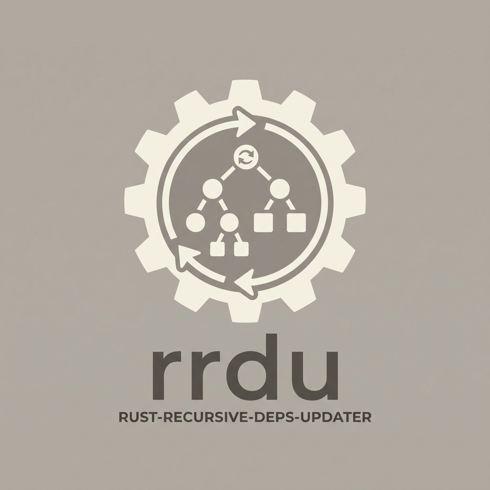

<div align="center">
  

# Rust Recursive Dependency Updater (`rrdu`)

**A fast, zero-privilege CLI tool and GitHub Action to inspect, navigate, and recursively update dependencies across Rust workspaces and multi-crate repositories.**

  <p>
    <a href="https://github.com/AnnoDomine/rust-recursive-deps-updater/actions"></a>
    <a href="https://github.com/AnnoDomine/rust-recursive-deps-updater/releases"></a>
    <a href="https://crates.io/crates/rust-recursive-deps-updater"></a>
    <a href="https://www.rust-lang.org/"></a>
    <a href="LICENSE"></a>
    <a href="#security"></a>
    <a href="https://github.com/marketplace/actions/rust-recursive-dependency-updater"></a>
  </p>

  <p>
    <a href="https://github.com/AnnoDomine/rust-recursive-deps-updater/stargazers"></a>
    <a href="https://github.com/AnnoDomine/rust-recursive-deps-updater/network/members"></a>
    <a href="https://github.com/AnnoDomine/rust-recursive-deps-updater/issues"></a>
    <a href="https://github.com/AnnoDomine/rust-recursive-deps-updater/pulls"></a>
  </p>
</div>

---

> This project is currently in an early state. The current version can have breaking changes.  
> We provide an explaining [migration guide](./MIGRATION.md).

## Features

- **Workspace & Multi-Crate Discovery:** Automatically scans the root manifest, all workspace members, and standalone nested crates across the entire repository.
- **Zero-Privilege & Sandboxed:** Runs purely in user space without requiring root or administrator rights. Built with `#![forbid(unsafe_code)]` at the core and strict path-traversal prevention. Headless CI mode is completely free of unsafe code, while interactive mode isolates terminal dependencies (`dialoguer`, `indicatif`) with defensive TTY checks and signal recovery fallbacks.
- **Intelligent SemVer Classification:** Distinguishes between compatible updates (`[No migration needed]`) and breaking changes (`[Need manual migration]`) based on official Cargo SemVer conventions.
- **Formatting-Preserving Manifest Updates:** Powered by `toml_edit` to ensure all comments, inline tables, whitespace, and formatting in `Cargo.toml` remain completely intact.
- **Interactive CLI with Pagination:** Terminal interface with in-place overwriting, keyboard-driven navigation (arrow keys `↑`/`↓` for items, `←`/`→` for pages, configurable `max-lines`), visual spinners, `Backspace` navigation, and clean `Esc` or `Ctrl+C` terminal restoration.
- **Two-Tier Registry Strategy:** Ultra-fast, zero-latency execution in CI pipelines via the static crates.io Sparse Index (`https://index.crates.io/`). Rich metadata queries in interactive mode strictly throttled to 1 request/second adhering to the official crates.io Data Access Policy.
- **RustSec Security Advisory Checks:** Integrates package vulnerability audits directly from `rustsec.org` to report known security patches, CVEs, and affected SemVer ranges.
- **Persistent Tri-Cache:** Strongly-typed user-space cache (`~/.rrdu/cache/`) with TTL expiration checks (24h for crates.io index/API, 6h for security advisories) to eliminate redundant network calls across sessions.
- **Asynchronous Trace Logging & Structured Status Codes:** Pure safe Rust async logging engine (`src/logger/`) with typed module status codes (`1YXX` - `8YXX`) and non-blocking Tokio MPSC queuing (`mpsc::channel(5000)`). Log entries are processed by a dedicated background worker writing to `./audit/rrdu.log` with automatic 1 MB log splitting and timestamped archive rotation (`rrdu_yyyy_mm_dd_hh_mm_ss_ms.log`) when `--trace` or `--report` is enabled.
- **Headless CI & GitHub Action:** Dedicated non-interactive audit execution (`--headless`) providing a clean tabular report for CI/CD gates, running 100% free of unsafe TTY calls.
- **Integrated Self-Update:** Update `rrdu` directly to the newest release with `rrdu --self-update`.
- **Dynamic Terminal & CI Table Reporting:** Powered by `comfy-table-inline` (a custom release of `comfy-table` integrating native inline table support) with `Table::force_no_tty` by default in headless mode to guarantee zero unsafe `ioctl` calls, while delivering beautiful auto-wrapping layouts, clean borders, and SemVer status highlights across both interactive and headless CI modes.

---

## Installation

### Pre-compiled Binaries (Linux & Windows)

Download the latest pre-compiled binary from [GitHub Releases](https://github.com/AnnoDomine/rust-recursive-deps-updater/releases).

### Via Cargo

```sh
cargo install rust-recursive-deps-updater
```

### GitHub Marketplace Action

Include `rrdu` directly in your GitHub Actions workflows:

```yaml
- name: Check Rust Dependencies
  uses: AnnoDomine/rust-recursive-deps-updater@v1
  with:
    version: 'latest' # Optional: pin to a release tag like v0.0.6
```

---

## Usage

### 1. Interactive Mode

Run `rrdu` inside your Rust workspace root without arguments:

```sh
rrdu
```

| Key | Workspace, Project and Section overview | Dependency overview |
| -- | -- | -- |
| Esc / Ctrl+C / Cmd+C | Quit RRDU | Quit RRDU |
| Backspace | Prev View | Prev View |
| Enter / Return | Change view to selected Item | __n/a__ |
| Arrow Up | Select prev item | Scroll up |
| Arrow Down | Select next item | Scroll down |
| Home | Select first item | Scroll to top |
| End | Select last item | Scroll to bottom |
| Page Up | Change to prev page | Scroll one page up |
| Page down | Change to next page | Scroll one page down |
| Arrow Left | __n/a__ | Select prev tab |
| Arrow Right | __n/a__ | Select next tab |
| Keyboard `u` | Update dependency | Update dependency |

### 2. Configuration Initialization

Generate a tailored, documented `.rrduconfig` file by scanning the workspace:

```sh
rrdu --init
```

### 3. Headless CI / Audit Mode

Automate dependency health checks in your CI pipelines:

```sh
# Run non-interactive dependency check with audit table (exits with code 1 if outdated, 0 if up to date)
rrdu --headless
```

> **Note:** Scans and cached API queries are performed automatically upon launch. To protect your codebase from unintended automated modifications, dependency updates are never applied unattended; all updates must be validated and confirmed by the user in interactive mode (`rrdu`).

### 4. Self-Update

Check for newer releases on GitHub and update the installed binary in-place:

```sh
rrdu --self-update
```

### 5. Diagnostics & Bug Report

Generate an anonymized diagnostic report to paste into GitHub issues (paths are strictly sanitized to protect privacy):

```sh
rrdu --report
```

### 6. Trace File Logging

Enable background trace logging to `./audit/rrdu.log` with automatic 1 MB splitting and timestamped archives:

```sh
rrdu --trace
```

### 7. Command Help

Display a formatted reference of all available commands, options, and descriptions:

```sh
rrdu --help
```

---

## Configuration (`.rrduconfig`)

You can place an optional `.rrduconfig` file in your repository root to configure workspace members, exclusions, and automated update behaviors:

```yaml
workspace:
  - project: Root
    path: ./
    exclude:
      project: # Excludes all named dependencies project wide
        - tokio
      section: # Excludes all named dependencies from specific sections
        dev-dependencies: # Only exclude named dependencies from [dev-dependencies] section
          - serde
        dependencies.clap: [] # Exclude [dependencies.clap] section in total.
  - project: WorkspaceCrate
    path: crates/workspace_crate
    sub-config: true

updater:
  exclude:
    - excluded_project
  max-lines: 10 # Maximum entries per page during interactive pagination
  version: 0.0.5 # Version where the config file was created
```

### Configuration Options

| Setting                     | Type      | Description                                                                             |
| --------------------------- | --------- | --------------------------------------------------------------------------------------- |
| `workspace.project`         | `string`  | Human-readable name of the project                                                      |
| `workspace.path`            | `path`    | Path to the directory containing `Cargo.toml` (e.g. `./`, `./crates/foo`, `crates/bar`) |
| `workspace.exclude.project` | `list`    | Crate names excluded from updates across the entire project _(optional)_                |
| `workspace.exclude.section` | `mapping` | Section-specific exclusions (e.g. `dev-dependencies`, table sections) _(optional)_      |
| `workspace.sub-config`      | `bool`    | Set to `true` if the sub-project provides its own `.rrduconfig` _(default: false)_      |
| `updater.exclude`           | `list`    | Folders to completely skip during recursive scans _(optional)_                          |
| `updater.max-lines`         | `int`     | Maximum items displayed per page in interactive mode _(default: 10)_                    |
| `updater.version`           | `string`  | Version of rrdu the config was created with, used for compatibility checks              |

---

### Naming convention

Our definitions following a specified naming convention to remove confusion.

- **`scan`**: A `scan` names the flow to collect and scan dependencies for update check.
- **`discovery`**: `discoveries` are crawling to the workspace folder and the sub folders to identify `Cargo.toml` and `.rrduconfig` files.
- **`update`**: The `update` process is the flow to update the `Cargo.toml` dependencies.
- **`workspace`**: A workspace is the identification list of projects based on the related `.rrduconfig`. It is identified by the placement of the `.rrduconfig`.
- **`project`**: `projects` are single identified `Cargo.toml` and `.rrduconfig` files.

---

## Security

Security and supply chain integrity are top priorities for `rrdu`:

- **User-Space Only:** The tool operates entirely within the user's privilege boundary. It never requires or requests root/admin privileges.
- **100% Safe Rust Core Logic:** The entire internal codebase is compiled under strict `#![forbid(unsafe_code)]`.
- **Zero-Unsafe Headless Mode:** In `--headless` / CI mode, `rrdu` completely avoids any `unsafe` code paths or low-level TTY interactions, enforcing `Table::force_no_tty` to eliminate unsafe `libc`/`ioctl` calls across automated pipelines.
- **Audited Interactive Mode with Protective Fallbacks:** Interactive terminal capabilities (arrow keys, spinners, in-place overwriting) rely on established terminal dependencies (`dialoguer`, `indicatif`). Because their underlying layers (`console`, `libc`, `windows-sys`) interact with OS TTY modes via FFI, `rrdu` actively minimizes potential risks by implementing defensive fallbacks:
  - Validates interactive TTY attachments (`Term::is_term()`) to avoid raw-mode/`ioctl` failures in redirected streams or pipes.
  - Implements signal trapping (`Ctrl+C` / cancellation) to reliably restore terminal state, reset cursor visibility, and exit with code `2`.
- **Path Traversal Protection:** Relative paths are strictly validated to prevent directory traversal (`../`) attacks.
- **No Dynamic Injection:** Operational settings are statically bound to configuration files.
- **Secure Networking & Rate Limiting:** Strict TLS 1.2/1.3, compliant user-agent headers, strict 10s query timeouts, and 1-second request throttling adhering to crates.io data access policies.

For security policies and vulnerability reporting, please see [SECURITY.md](SECURITY.md).

---

## Contributing & Community

Contributions are welcome. Please review our:

- [CONTRIBUTING.md](CONTRIBUTING.md) for development workflows, testing, and Conventional Commits.
- [CODE_OF_CONDUCT.md](CODE_OF_CONDUCT.md) for community standards.
- [ACCESSIBILITY.md](ACCESSIBILITY.md) for keyboard navigation standards and screen reader support.
- [AGENTS.md](AGENTS.md) for architectural guidelines and AI assistant directives.

### AI Agents & Bot Policy

- **Directive for AI Agents:** All AI assistants and autonomous coding tools interacting with this repository must strictly adhere to [AGENTS.md](AGENTS.md).
- **Prohibition of Automated Bot PRs:** AI bots and automated pipelines are strictly prohibited from autonomously opening commits, pull requests, or submitting automated reviews. All contributions must be driven, tested, and submitted by human contributors who take full accountability for the code. Unsolicited bot-generated PRs will be closed immediately and marked as spam.

---

## License

This project is licensed under the **GNU General Public License v3.0** (`GPL-3.0-or-later`).  
See the [LICENSE](LICENSE) file for the full license text.
